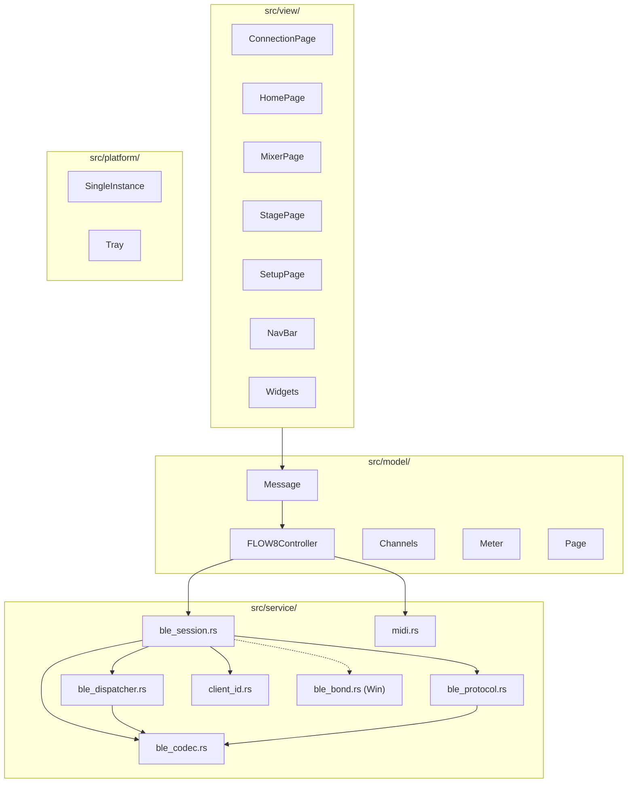
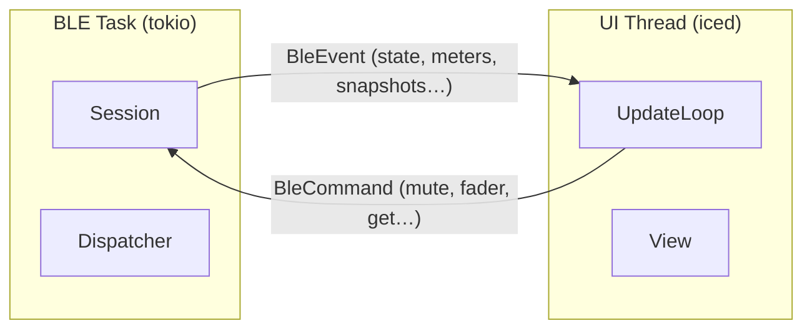

# FLOW 8 Desktop v2

Reescrita completa da aplicação desktop Rust/iced para o mixer Behringer FLOW 8.
BLE nativo como canal primário (protocolo completo conforme [`ble-wire-map.md`](../rea/ble-wire-map.md)),
UI redesenhada via Penpot, distribuição cross-platform.

USB MIDI mantido como fallback quando BLE não está disponível (sistemas sem Bluetooth) ou como opção manual do usuário.

## Referências

- Protocolo BLE: [`docs/rea/ble-wire-map.md`](../rea/ble-wire-map.md) — spec completa (GATT, framing, commands, MixerState, auth, pairing, metering)
- Catálogo de comandos: [`docs/rea/data/xairbt_cmd_catalog.json`](../rea/data/xairbt_cmd_catalog.json)
- LUT fader/send: [`docs/rea/data/uf8_scale3_lut.json`](../rea/data/uf8_scale3_lut.json)
- PR #17 review: [`pr-17-review.md`](../../pr-17-review.md)

---

## Decisões técnicas

- **BLE primário.** Sessão conforme §7 do wire map. USB MIDI é secundário.
- **Modelo nativo BLE.** `FLOW8Controller` armazena valores uf8/scales nativos. Conversão via LUT.
- **Codec separado.** `ble_codec.rs` encapsula framing §2, field types §3, checksum. Testável isoladamente.
- **Async via tokio channels.** BLE session em task tokio. Comunicação com UI via `mpsc` tipado (`BleEvent` / `BleCommand`).
- **Loop bidirecional em tempo real.** Análogo ao APK: Mixer→UI via `iced::subscription::channel` — cada notificação BLE vira `Message` no `update()` sem polling. UI→Mixer via `BleCommand` enviado ao sender da session — mixer ecoa de volta pela notificação, confirmando a mudança na UI.
- **WinRT PairAsync.** Crate `windows` para bond OS antes do CCCD. `#[cfg(target_os = "windows")]`.
- **Client ID em arquivo.** `~/.flow8-midi/client_id` — 16 bytes hex. Sem keyring.
- **iced 0.14.** Manter framework atual.
- **Single-instance nativo.** CreateMutexW (Win), lock file (Linux/macOS). Sem TCP port.
- **Tray em todas as plataformas.** Close-to-tray opt-in (default off).
- **Design-first.** Penpot boards aprovados antes da implementação de cada tela. Implementação via Penpot MCP.
- **Código legado.** `sysex_parser.rs` mantido e refatorado para USB mode (U14a). `sysex_calibration.rs`, `bin/calibrate.rs`, `bin/digest.rs` e feature `dev-tools` removidos — eram ferramentas de engenharia reversa via SysEx dump, substituídas pelo wire map BLE. `midi_mapper.rs` mantido para controle USB (CC/Note On/PC). Hex dump viewer reimplementado como debug panel no modo dev se necessário.

---

## Arquitetura

### Comunicação BLE ↔ UI

---

## Fases

### Fase 0 — Design (Penpot) + Atualização de dependências

**Executadas em paralelo.** O design é definido e aprovado antes de qualquer implementação de UI. A atualização de dependências prepara o código para a reescrita.

#### U0a. Penpot Design Completion

Completar e refinar todos os boards no Penpot, contemplando o protocolo BLE completo documentado no wire map.

**Boards necessários:**
- Connection (session states: Idle, Scanning, Connecting, PairingRequired, Error)
- Home (Welcome, Continue Session, Start New, Load Snapshot, firmware notice)
- Main Mixer (bus selector, meters, dB display, faders, M/S, Edit, strips)
- Stage (performance cards, faders/meters horizontais, Mute/Solo)
- EQ detail (PEQ 4 bandas inputs, GEQ 9 bandas outputs)
- Sends detail (Mon1, Mon2, FX1, FX2 faders por canal)
- FX (preset selector, parâmetros, Tempo/BPM, enable toggles)
- Setup (Device Info, Mixer Settings, Channel Labels, App Settings, About)
- Snapshots (grid com Save/Delete/Rename inline)

**Gate:** Todos os boards aprovados antes de iniciar qualquer implementação de UI (Fase 3).

#### U0b. Upgrade Cargo.toml + Rust edition

Atualizar versões de crates e Rust edition antes da reescrita.

| Crate | Atual | Target | Nota |
|-------|-------|--------|------|
| `midir` | 0.10 | **0.11** | Minor bump. Verificar breaking changes no WinRT backend. |
| `winresource` | 0.1.17 | **0.1.34** | Patch — manifesto DPI e ícone. |
| `image` | 0.25.1 | **0.25.10** | Patch. |

Crates já no latest semver (sem ação): `iced` 0.14, `tokio` 1.x, `chrono` 0.4, `uuid` 1.x, `tokio-stream` 0.1, `hostname` 0.4.

Crates adiados para a unit que reescreve o código afetado:
- `btleplug` 0.11→0.13: bump junto com U3 (BLE Session), que reescreve `ble.rs`
- `edition` 2021→2024: aplicar após Fase 2, quando o código legado já foi substituído

**Procedimento:**
1. Bump versions no `Cargo.toml` (midir, winresource, image)
2. `cargo build` — corrigir eventuais breaking changes
3. `cargo test` + `cargo clippy`
4. Verificar que BLE connect + USB MIDI continuam funcionais antes de prosseguir

#### U0c. CI básico (GitHub Actions)

Pipeline mínimo para garantir compilação cross-platform desde o início.

- GitHub Actions em PRs: `cargo fmt --check`, `cargo clippy`, `cargo test`, `cargo build` × 3 plataformas (Linux, macOS, Windows)
- Sem empacotamento ou release nesta fase — apenas build e test

---

### Fase 1 — BLE Foundation

#### U1. Client ID

Gerar, persistir e carregar client ID de 16 bytes em `~/.flow8-midi/client_id`.

- `src/service/client_id.rs`: `load_or_create() -> [u8; 16]`, `build_handshake_packet(id) -> [u8; 19]`
- Deps: `rand`, `dirs`

#### U2. Packet Codec

Encoder/decoder para framing §2 e field types §3 do wire map.

- `src/service/ble_codec.rs`
- Single-chunk e multi-chunk encode/decode com checksum
- Field types: u8, u16be, u32be, uf8 (scales 1–6), bool bitpack, string, blob
- `MultiChunkAssembler` para reassemblar `0x38`
- Scale-3 LUT embutida via `include_str!`

#### U3. BLE Session

Sessão conforme §7: subscribe → `0x35` → `0x39` → `0x36` → `0x37` → `0x38`.

- Bump `btleplug` 0.11→0.13 nesta unit (API muda subscribe e peripheral — código será reescrito aqui)
- `src/service/ble_session.rs`: state machine `Disconnected → Connected → Subscribing → WaitingHandshake → PairingRequired → Authenticating → RequestingState → Active`
- Reescrever `connect_and_auth` em `ble.rs`: subscribe **antes** de qualquer write
- Remover `AUTH_PACKET` hardcoded — usa `client_id::build_handshake_packet`
- Extrair `pairing_any` do `0x35` para decisão de pairing

#### U4. WinRT PairAsync

Bond OS no Windows antes do subscribe CCCD. Resolve `0x80650003`.

- `src/service/ble_bond.rs`: `ensure_bonded(address: u64) -> Result<(), String>`
- `#[cfg(target_os = "windows")]`: crate `windows` com `Devices_Enumeration`, `Devices_Bluetooth`, `Foundation`
- `#[cfg(not(target_os = "windows"))]`: no-op
- Chamado entre GATT connect e subscribe na session (U3)

#### U5. Pairing Flow

Quando mixer rejeita client ID (`pairing_any=false` + ID desconhecido): prompt na UI.

- Session (U3) detecta pairing required → estado interno `SessionState::PairingRequired`
- Session emite `BleEvent::PairingRequired` via channel → iced subscription converte em `Message`
- UI atualiza `BleStatus::PairingRequired` (representação na view, derivada do event)
- Session mantém notify stream ativo; ao receber `0x35` com `pairing_any=true`, retoma handshake
- Timeout 30s → `BleEvent::Disconnected` com mensagem
- Primeira conexão com client_id desconhecido pelo mixer: dica proativa de pairing

---

### Fase 2 — BLE Control

#### U6. Command Encoder

Encoding de todos os comandos outbound (host→device) conforme §5.

- `src/service/ble_protocol.rs`: enum `BleCommand` com variantes para cada command type
- `encode_command(cmd) -> Vec<u8>` usando codec de U2
- Channel IDs §4, scales corretos por comando

#### U7. Notification Dispatcher

Loop de notificações BLE com dispatch por type byte para handlers tipados.

- `src/service/ble_dispatcher.rs`: match `0x35`/`0x36`/`0x38`/`0x22`/`0x27`/`0x25`/`0x24`/controles
- Cada handler converte payload em `BleEvent` via channel para UI
- Enum `BleEvent`: HandshakeHost, HandshakeAck, MixerState, MeterUpdate, SnapshotList, Setting, ChannelLabels, ControlEcho, PairingRequired, Disconnected

#### U8. MixerState Decoder

Deserializar `0x38` multi-chunk conforme §6.

- `decode_mixer_state(payload) -> MixerStateData`: 7 inputs §6.1, 3 outputs §6.2, 2 FX §6.3, trailing flags
- `apply_mixer_state(data, controller)`: preencher `FLOW8Controller` com valores nativos

#### U9. Metering

`0x21` MeterRequest → `0x22` MeterUpdate contínuo.

- `src/model/meter.rs`: `MeterState` com levels, peaks, gain reduction
- Decode 15× uf8 scale 3 via LUT, meter index → channel §5.5
- Peak hold 1.5s + decay
- Re-request se timeout 2s sem `0x22`

#### U10. Snapshots via BLE

Gerenciamento completo: list, save, load, delete, rename.

- `0x07` GetList → `0x27` parse, `0x19` Save, `0x20` Load, `0x12` Delete, `0x32` Rename
- Refatorar `parse_snapshot_names` existente para usar codec U2

#### U11. FX via BLE

- `0x31` FXLoadPreset, `0x11` FXSetup, `0x40` FXTempo (u16be BPM)

#### U12. Settings via BLE

- `0x26` GetSetting / `0x25` Setting para todas as tags §5.4.1
- `0x23` GetChannelLabels / `0x24` ChannelLabels parse / `0x05` ChannelLabel write

#### U13. Reconexão automática

Detectar desconexão BLE → reconectar com client ID persistido (sem botão de pairing).

#### U14. ChannelConnectionState (`0x33`/`0x34`)

Receber notificações de conexão física de canais (cabo plugado/desplugado).

- Tratar `0x33` no dispatcher: `id`, `sub_channel`, `connected:bool`
- Atualizar indicador visual de conexão por canal no model (campo `connected_l`/`connected_r` em `Channel`)
- Exibir no mixer strip (ícone ou cor indicando canal com/sem sinal plugado)

#### U14a. USB MIDI Mode

Fallback para sistemas sem Bluetooth ou como opção manual.

- **Mixer→App (read):** SysEx dump request periódico → `sysex_parser` preenche o mesmo `FLOW8Controller` que o BLE usa. Parâmetros cobertos: levels, gains, pans, compressors, EQ, sends, mutes, solos, phantoms, bus levels, FX.
- **App→Mixer (write):** MIDI CC/Note On/Program Change para controles suportados (faders, mutes, solos, program change para snapshots).
- **Não disponível em USB:** metering em tempo real, pairing, settings §5.4.1, channel labels write, snapshot save/delete/rename.
- Connection Page oferece "Connect via USB MIDI" quando dispositivo FLOW 8 é detectado via `midir`.
- UI idêntica ao modo BLE — features indisponíveis ficam desabilitadas com tooltip explicativo.

---

### Fase 3 — UI (via Penpot MCP)

Implementação das telas conforme designs aprovados na Fase 0a, usando o MCP do Penpot como referência direta. Todos os boards aprovados antes de iniciar esta fase (gate U0a).

#### U15. Connection Page

Substitui `device_select_page.rs`. BLE primário, USB secundário.

- Estados visuais: Idle, Connecting (BLE) / Scanning (USB), PairingRequired (só BLE), Connected, Error
- Estados internos da session (Subscribing, WaitingHandshake, etc.) não aparecem na UI — agrupados como "Connecting"
- Botão primário "Connect via Bluetooth", secundário "Connect via USB MIDI"
- Dica de pairing quando `PairingRequired`

#### U16. Home Page

- Welcome, firmware notice dismissável, ações: Continue Session, Start New, Load Snapshot
- Firmware notice baseado em `protocol_version`/`firmware_build` do `0x35`

#### U17. Navigation

- Navbar: Home | Main | Setup + BT indicator + Disconnect
- Sub-tabs Main: Mixer | Stage
- Bus selector dentro de Mixer: Mix bus, FX1, FX2, Mon1, Mon2, Main

#### U18. Main Mixer

- Channel strips: nome, label, meter bars, peak, M/S, send selector, fader, dB display, Edit
- Bus strips: Main, Mon 1, Mon 2 com fader, M, dB, Edit; FX1/FX2 com "Open FX"
- Bus selector muda view (Main level vs sends Mon1/Mon2/FX)

#### U18a. EQ Page

- PEQ por canal: frequência, Q, gain (`0x09` ChannelPEQ)
- GEQ por canal: frequência, Q, gain (`0x03` ChannelGEQ)
- HPF: on/off + frequência (`0x04` ChannelHPF)
- Visualização conforme board Penpot EQ

#### U18b. Sends Page

- Níveis de send por canal para cada bus (Mon1, Mon2, FX1, FX2) via `0x06` ChannelMaster (src→dst)
- Visualização conforme board Penpot Sends

#### U19. Stage View

- Grid de performance cards com meter horizontal, fader horizontal, Mute/Solo, Pan

#### U20. Setup Page

- Device Info (nome editável, firmware, protocol)
- Mixer Settings (todas as tags §5.4.1 via BLE)
- Channel Labels (editar via `0x05`)
- App Settings (theme, sync interval, close-to-tray toggle)
- About (versão, autor, links)

#### U21. FX Page

- Preset selector (`0x31`), parâmetros (`0x11`), Tempo/BPM (`0x40`), enable per bus

#### U22. Snapshots Page

- Grid com nomes, save/load/delete/rename via BLE

---

### Fase 4 — Platform

#### U24. Single-Instance

- Windows: `CreateMutexW`
- Linux/macOS: lock file `~/.flow8-midi/lock`
- Se falhar: dialog nativo + sair

#### U25. System Tray (todas as plataformas)

- Crate `tray-icon` (cross-platform: Windows, macOS, Linux)
- Menu: Show/Hide, Exit
- Close-to-tray: opt-in (default off), configurável em App Settings

---

### Fase 5 — Distribuição

#### U26. Linux AppImage

- `linuxdeploy` + `appimagetool`
- Incluir `libdbus-1` e deps Bluetooth
- Compilar em Ubuntu 22.04 (glibc baseline)
- Desktop file + ícone

#### U27. macOS .app Bundle

- `cargo-bundle` com Universal Binary (aarch64 + x86_64 via `lipo`)
- `NSBluetoothAlwaysUsageDescription` no Info.plist
- Code signing ad-hoc (dev), Apple Developer (release)

#### U28. Windows .exe

- DPI awareness manifest (PerMonitorV2) via `winresource`
- Ícone embeddado (já funcional)

#### U29. Release pipeline

- GitHub Actions em tags: build release × 3 plataformas → AppImage + .app.zip + .exe + checksums SHA256
- CI de PRs já existe desde U0c

---

## Critério de pronto

| Fase | Critério |
|------|----------|
| 0 — Design + Deps + CI | Todos os boards Penpot completos e aprovados. Dependências atualizadas. CI cross-platform passando (fmt, clippy, test, build × 3). |
| 1 — BLE Foundation | Client ID persistido. Session §7 correta. Windows CCCD funciona. `0x38` recebido. Pairing flow funcional. |
| 2 — BLE Control | Controle bidirecional (mute, volume, pan, gain). MixerState preenche controller. Meters em tempo real. Snapshots, FX, Settings, Labels via BLE. Reconexão automática. |
| 3 — UI | Todas as telas implementadas conforme Penpot aprovado. Meters visíveis. Bus selector funcional. |
| 4 — Platform | Single-instance em 3 plataformas. Tray em 3 plataformas. Close-to-tray opt-in. |
| 5 — Distribuição | AppImage, .app, .exe funcionais. Release pipeline gerando artifacts em tags. |

**Global:**
- `cargo build` + `cargo test` + `cargo clippy` sem erros
- Conexão BLE completa funcional em Linux, Windows e macOS
- Metering funcional com sinal real no mixer
- Controle bidirecional para todos os parâmetros do wire map §5
- Snapshots save/load/delete/rename via BLE
- Client ID persistido e reutilizado entre sessões
- Todos os designs UI aprovados no Penpot antes da implementação
- Distribuíveis funcionais nas 3 plataformas
- CI cross-platform (desde Fase 0) + release pipeline (Fase 5) funcionais

---

## Testes manuais por fase

Sequência de testes manuais com mixer real para validar cada fase antes de avançar.

### Fase 1 — BLE Foundation
1. Iniciar app sem `~/.flow8-midi/client_id` → arquivo criado automaticamente
2. Conectar via BLE com mixer ligado → session completa (subscribe → `0x35` → `0x39` → `0x36` → `0x37` → `0x38`)
3. Verificar que `0x38` chega e popula o controller com valores do mixer
4. Desconectar → reconectar → client ID reutilizado, aceito sem pairing
5. Deletar `client_id` → conectar sem apertar botão pairing → UI mostra PairingRequired
6. Apertar botão pairing no mixer → conexão completa
7. (Windows) Verificar que WinRT PairAsync executa antes do subscribe, sem erro `0x80650003`

### Fase 2 — BLE Control
1. Mover fader no app → mixer reflete imediatamente (ouvir mudança de volume)
2. Mover fader no mixer → app reflete imediatamente (UI atualiza)
3. Mute/Solo no app → mixer reflete; mute/solo no mixer → app reflete
4. Pan, gain, compressor, limiter, phase, phantom: app↔mixer bidirecional
5. EQ (PEQ + GEQ + HPF): alterar parâmetros no app → mixer reflete
6. Sends (Mon1, Mon2, FX1, FX2): alterar níveis no app → mixer reflete
7. Meters: passar sinal nos canais → bars animam em tempo real na app
8. Snapshots: save, load, delete, rename via app → verificar no mixer
9. FX: trocar preset, alterar parâmetros, mudar tempo/BPM → mixer reflete
10. Settings: alterar cada tag §5.4.1 via app → verificar no mixer
11. Channel labels: renomear canal no app → mixer reflete
12. Reconexão: desligar mixer → religar → app reconecta automaticamente
13. USB MIDI: conectar via USB → SysEx dump popula controller → CC altera mixer
14. USB MIDI: features BLE-only (metering, snapshots save, settings) desabilitadas com tooltip

### Fase 3 — UI
1. Connection Page: estados visuais corretos (Idle → Connecting → Connected / PairingRequired / Error)
2. Home Page: firmware notice aparece, ações funcionam
3. Navigation: todas as rotas acessíveis, navbar destaca página ativa
4. Main Mixer: channel strips com meter, fader, M/S, bus selector muda view
5. EQ Page: PEQ/GEQ/HPF editáveis, valores refletem no mixer
6. Sends Page: níveis por canal/bus editáveis, valores refletem no mixer
7. Stage View: cards com meter, fader, mute/solo funcionais
8. Setup Page: device info, settings, labels, about — tudo editável
9. FX Page: preset selector, parâmetros, tempo — tudo funcional
10. Snapshots Page: grid com save/load/delete/rename funcional

### Fase 4 — Platform
1. Abrir segunda instância → dialog nativo + fecha (Windows, Linux, macOS)
2. Tray icon aparece, menu Show/Hide e Exit funcionam
3. Close-to-tray off (default) → fechar janela encerra app
4. Close-to-tray on → fechar janela minimiza para tray

### Fase 5 — Distribuição
1. Linux: AppImage executa, conecta via BLE, controla mixer
2. macOS: .app executa, Bluetooth permission prompt aparece, conecta, controla
3. Windows: .exe executa, DPI correto, ícone visível, conecta, controla
4. Release pipeline: push tag → GitHub Actions gera artifacts com checksums

---

## Fora do escopo

- `0x42`/`0x43`/`0x44` Data Transfer (firmware update)
- `0x45`/`0x46` MIDI mapping customizado
- `0x4b` SysexMidiDump como fluxo principal (é dump/export)
- Mobile app (Android/iOS)
- Suporte a múltiplos mixers simultâneos
- Auto-update
- Internacionalização (i18n) — UI em inglês
- Notarização Apple (`notarytool`)
- MSI/NSIS installer Windows
- Flatpak/Snap Linux
