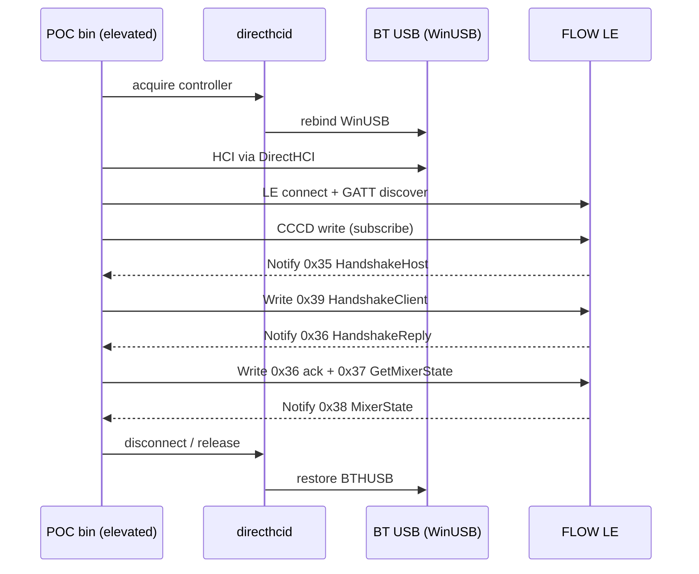

# feat: POC DirectHCI BLE handshake até MixerState

## Goal Capsule

- **Objective:** Provar no Windows que uma pilha HCI user-mode consegue ativar Notify no FLOW 8 e completar o handshake até o primeiro `MixerState` (`0x38`), contornando o bloqueio WinRT/CCCD (`0x80650003`).
- **Means:** Binário Rust descartável que usa `directhci-ble` (serviço DirectHCI + TrouBLE) no adaptador Bluetooth do PC com takeover temporário WinUSB.
- **Authority:** Este plano > wire map BLE (`docs/rea/ble-wire-map.md` §7) > código de referência em `src/service/ble_session.rs` > README/compatibilidade do DirectHCI.
- **Stop when:** O POC imprime confirmação de `0x38` recebido (ou falha com diagnóstico claro) e libera o controlador de volta ao Windows; não embute instalador nem troca o backend do app principal.

## Product Contract

### Summary

POC descartável: DirectHCI no BT do PC, sessão até `0x38`, crate/programa separado. Não é caminho de produto nem substituto do `btleplug`/WinRT.

### Problem Frame

No Windows, `btleplug` + WinRT frequentemente falha ao escrever o CCCD (HRESULT `0x80650003` / ATT Write Not Permitted). Pairing OS e reconnect mitigam em alguns hosts, mas não são confiáveis. Sem Notify, o FLOW 8 não envia `HandshakeHost` (`0x35`) e a session §7 não arranca. Uma pilha HCI raw pode escrever o CCCD sem a validação UWP.

### Requirements

- R1. O POC roda no Windows como processo separado do `flow-8-midi`, sem alterar o fluxo BLE de produção.
- R2. Usa o adaptador Bluetooth do PC via DirectHCI (takeover temporário + restore), não um dongle Zadig permanente.
- R3. Completa o fluxo de `ble_session` até detectar `MixerState` (`0x38`): connect → subscribe CCCD → wait `0x35` → send `0x39` → wait `0x36` (com ramo `pairing_any=false` se necessário) → write ack host `0x36` + `0x37` → receive `0x38` (primeiro notify com `cmd_type==0x38` ou assembler completo).
- R4. Em falha, loga etapa + erro (service down, prepare missing, CCCD write, timeout handshake) e garante tentativa de `disconnect`/`shutdown` para devolver o rádio ao Windows.
- R5. Documenta pré-requisitos mínimos (DirectHCI instalado, controller prepared, elevação UAC, teclado/mouse com fio) num README do POC.

### Success Criteria

- Com FLOW 8 anunciando e DirectHCI ready, o binário POC chega a `0x38` sem usar WinRT GATT.
- Após saída (sucesso ou erro), o controlador volta a `WindowsOwned` (verificável via `directhci.exe status` / Control Panel).
- O app principal permanece intacto (`btleplug` path inalterado).

### Scope Boundaries

**In scope**

- Scaffold do crate/binário POC
- Integração `directhci-ble` (git/path)
- Scan/filter FLOW LE, connect, GATT discover, `subscribe`, handshake mínimo, dump/`0x38`
- README operacional do POC

**Out of scope**

- Instalador embutido, bundling do DirectHCI no release do flow-8-midi
- Substituição de `ble_session` / UI iced
- Metering contínuo (`0x21`/`0x22`), labels, snapshots, writes de UI
- Pairing físico completo no mixer além do necessário para aceitar o `client_id` (se `pairing_any=false`, o POC pode instruir o usuário e esperar um timeout curto)

### Deferred to Follow-Up Work

- Feature-flag / backend Windows no app principal, se o POC passar
- Avaliar dongle dedicado + `bt-hci-usb` como plano B de hardware
- Empacotar DirectHCI no instalador do produto (só após estabilidade comprovada)

### Key Decisions

- KD1. DirectHCI no BT embutido, não dongle Zadig. *(session-settled: user-directed — chosen over dedicated USB dongle + bt-hci-usb: temporary rebind restores Windows BT)* — Governs R2
- KD2. Sucesso = receber `0x38`, não só CCCD. *(session-settled: user-directed — chosen over “CCCD + first notify only”)* — Governs R3
- KD3. Artefato = programa/crate separado descartável. *(session-settled: user-directed — chosen over feature flag in main app)* — Governs R1
- KD4. Modo POC, não produto. *(session-settled: user-approved — chosen over shipping DirectHCI in the app installer)* — Governs Scope Boundaries

### Assumptions

- O host de teste consegue instalar DirectHCI `0.1.0-alpha.1` e preparar o controlador (Intel AX201 é o único hardware com resultados publicados; outros controladores são risco).
- O processo POC pode correr elevado (DirectHCI exige admin para acquire).
- O UUID GATT do FLOW 8 permanece `14839ad4-…` / `0034594a-…` (como em `ble_session.rs`).
- Reutilizar encode/decode do protocolo via path dependency numa lib fina, ou copiar o mínimo no POC, é aceitável; não exigir refactor grande do app.

### Actors

- A1. Desenvolvedor no Windows (GPD / desktop com BT USB)
- A2. Mixer FLOW 8 (periférico BLE “FLOW LE”)
- A3. Serviço DirectHCI (`directhcid`) + Control Panel

### Key Flows

- F1. Setup one-shot: instalar DirectHCI → Start Service → Prepare Controller → Ready
- F2. Run POC (elevated): acquire → scan → connect FLOW LE → subscribe → handshake → `0x38` → disconnect → Windows restore
- F3. Failure path: erro em qualquer etapa → log → cleanup → restore

### Acceptance Examples

- AE1. DirectHCI ready + FLOW 8 ligado → POC imprime `MixerState (0x38) received` e exit 0; BT Windows volta.
- AE2. Serviço parado → POC falha cedo com mensagem “start DirectHCI service”, sem hang.
- AE3. CCCD write falha mesmo via HCI → POC falha na etapa `subscribe` com erro ATT; hipótese WinRT fica invalidada e o problema passa a ser pairing/encryption no periférico.

## Planning Contract

### Key Technical Decisions

- KTD1. Depender de `directhci-ble` do checkout/git [NanamiKite/DirectHCI](https://github.com/NanamiKite/DirectHCI) (crates unpublished). *(session-settled: user-directed — DirectHCI over bt-hci-usb dongle path)* Covers R2
- KTD2. Colocar o POC em `poc/flow8-directhci/` como package Cargo independente (não workspace member obrigatório do app, para não forçar Rust 1.87 / edition 2024 no binário principal). Covers R1, KD3
- KTD3. Reutilizar framing do protocolo: preferir path dep a um crate fino `flow8-ble-wire` **só se** a extração for trivial; senão copiar helpers mínimos. Writes: `0x39` = 16 bytes raw; `0x36`/`0x37` = frame completo — ver U3. Covers R3
- KTD4. Espelhar a ordem de `ble_session` §7; pairing UI do mixer fica opcional com timeout curto e mensagem clara. Covers R3, R4
- KTD5. Tratar regressões GATT do DirectHCI alpha como risco de execução: se `subscribe`/connect falhar de forma sistemática, documentar evidência e parar — não reinventar stack no POC.

### High-Level Technical Design



Componentes: POC bin → `directhci-ble` → named pipe → `directhcid` → WinUSB HCI → radio → FLOW 8.

### System-Wide Impact

- **Devs:** novo toolchain/runtime no Windows (DirectHCI installer, UAC, possivelmente Rust ≥ 1.87 só para o POC).
- **End users:** nenhum impacto enquanto o POC não for produto.
- **Ops/support:** risco de BT indisponível durante a sessão; recovery documentado no README do DirectHCI.

### Implementation Units

### U1. Scaffold do POC + dependência DirectHCI

**Goal:** Package Rust compilável no Windows que liga a `directhci-ble` e falha com diagnóstico se o serviço não estiver ready.

**Requirements:** R1, R2, R5 — Approach: KTD1, KTD2

**Files:**
- Create: `poc/flow8-directhci/Cargo.toml`
- Create: `poc/flow8-directhci/src/main.rs`
- Create: `poc/flow8-directhci/README.md`
- Optional: `poc/flow8-directhci/rust-toolchain.toml` (pin 1.87+ se necessário)

**Approach:**
- Binário `flow8-directhci-poc` com `tokio` current_thread ou multi-thread.
- Dependency `directhci-ble` via `git = "https://github.com/NanamiKite/DirectHCI"` + `path` no monorepo upstream, ou submodule/checkout irmão documentado no README.
- `BleCentralConfig` com `client_name = "flow8-directhci-poc"`; `controller_id` via CLI/`--controller` se >1 adapter.
- README: instalar DirectHCI, Prepare Controller, teclado com fio, run as Admin, como verificar restore.

**Test scenarios:**
- Happy: `cargo check` (ou build) do package com DirectHCI no path configurado.
- Error: sem serviço → mensagem aponta Start Service / Control Panel (manual no host Windows; automatizar só se houver mock — não obrigatório no POC).
- Edge: múltiplos controllers sem `--controller` → erro pedindo id explícito.

**Verification:**
- Package builds against documented DirectHCI revision.
- README lista pré-requisitos e recovery.

---

### U2. Scan + connect + subscribe CCCD

**Goal:** Encontrar “FLOW LE”, conectar, descobrir GATT, `subscribe` na characteristic do protocolo.

**Requirements:** R2, R3, R4 — Approach: KTD1, KTD5

**Files:**
- Modify: `poc/flow8-directhci/src/main.rs` (ou `scan.rs` / `gatt.rs` se crescer)

**Approach:**
- Scan 5–10s; filtrar `local_name` contendo `FLOW` / `FLOW LE` (mesmo critério mental do app; espelhar `find_flow8` se possível).
- UUIDs: service `14839ad4-8d7e-415c-9a42-167340cf2339`, characteristic `0034594a-a8e7-4b1a-a6b1-cd5243059a57`.
- `find_characteristic` → `subscribe` (CCCD write). Não usar só `listen` (isso não habilita Notify no peer).
- Logar handles/UUIDs descobertos e presença de descriptor `0x2902` se a API expor.

**Test scenarios:**
- Happy: FLOW 8 anunciando → connect + subscribe OK.
- Error: mixer off → “device not found” após scan.
- Error: subscribe ATT reject → falha na etapa `subscribe` com código/erro; cleanup release.
- Edge: nome vazio no adv → fallback por UUID de serviço se DirectHCI expor scan data suficiente; senão documentar limitação.

**Verification:**
- Log mostra `subscribe OK` sem WinRT.
- Em falha, `directhci` status volta a WindowsOwned após exit.

---

### U3. Handshake §7 até MixerState `0x38`

**Goal:** Reproduzir o caminho feliz de `ble_session` até o primeiro `0x38`.

**Requirements:** R3, R4 — Approach: KTD3, KTD4 — Execution note: smoke-first no hardware real; unit tests só para encode/parse local se houver módulo wire.

**Files:**
- Modify: `poc/flow8-directhci/src/main.rs`
- Optional create: `poc/flow8-directhci/src/wire.rs` (encode/parse mínimo)
- Reference (read-only): `src/service/ble_session.rs`, `src/service/ble_protocol.rs`, `src/service/ble_codec.rs`, `src/service/client_id.rs`, `docs/rea/ble-wire-map.md`

**Approach:**
- Após subscribe, stream de notifications na characteristic (API `subscribe` + recv; não só `listen` passivo).
- Timeout ~10s aguardando `0x35`; parse `pairing_any` como no protocolo.
- Preferir ler `~/.flow8-midi/client_id` se existir; senão gerar 16 bytes efêmeros (pode forçar ramo de pairing).
- **Writes GATT (crítico — espelhar `ble_session.rs`):**
  - `0x39` HandshakeClient: escrever **apenas** os 16 bytes de `client_id` (payload), **não** o frame `encode_single` completo (`write_raw` no app).
  - Ack host `0x36` vazio + `0x37` GetMixerState: escrever o **frame completo** (`encode_single` / `encode_command`, com type+chunks+checksum).
- Após `0x39`: wait `0x36` **ou** novo `0x35` (como `ble_session` 347–364). Se `pairing_any=false` e sem ack: log “press pairing on mixer”, wait até ~30s, reenviar `0x39`.
- Ordem canônica pós-ack: write framed `0x36` (vazio) **depois** `0x37` — seguir `ble_session.rs` 450–458, não só a lista condensada do wire-map §7.
- Sucesso `0x38`: `raw[0]==0x38` no primeiro notify **ou** assembler multi-chunk até evento completo. **Não** usar `decode_single` em fragmentos com `total_chunks>1`.
- `finally`: `disconnect` + `shutdown`.

**Test scenarios:**
- Happy: `pairing_any=true` → sequência completa → print bytes/len do primeiro notify `0x38` → exit 0.
- Happy/edge: `client_id` persistido do app aceito → mesmo path.
- Edge: `pairing_any=false` + botão pairing → ack após reenvio; sem botão → timeout nomeado (não atribuir a CCCD).
- Error: timeout em `0x35` → mensagem “notify/handshake host missing”.
- Error: timeout em `0x36`/`0x38` → etapa nomeada + cleanup.
- Integration (manual): AE1–AE3 no host Windows.

**Verification:**
- Exit 0 com linha explícita de sucesso `0x38`.
- Comparação qualitativa: mesmo host onde WinRT falha no app, POC passa (ou documenta se ambos falham).

---

### U4. Relatório do spike (go/no-go)

**Goal:** Registrar resultado para decidir follow-up de produto.

**Requirements:** R5 — Approach: KD4

**Files:**
- Create: `poc/flow8-directhci/RESULTS.md` (ou secção no README)
- Optional note in: `docs/plans/` only if linking from this plan’s appendix later

**Approach:**
- Template: hardware (VID:PID, controller name), Windows build, DirectHCI revision, passos OK/FAIL, logs chave, conclusão go/no-go para backend Windows.
- Não mergeia backend no app neste plano.

**Test scenarios:**
- Test expectation: none — documentação de evidência.

**Verification:**
- Arquivo preenchido após a corrida no hardware.

### Dependencies & Sequencing

```text
U1 → U2 → U3 → U4
```

U1 bloqueia tudo. U2 e U3 são sequenciais no mesmo binário. U4 só após corrida em hardware.

### Risks

| Risk | Mitigation |
|------|------------|
| DirectHCI alpha: GATT timeout/disconnect pós-extração da CLI | Usar CLI `directhci-ble.exe subscribe` como sanity check antes do crate; pin revision que funcionar |
| Controller ≠ AX201 | Documentar; se Prepare falhar, spike aborta com evidência |
| Admin elevation atrito | Esperado no POC; README explícito |
| Sequestro do rádio derruba mouse BT | Exigir input com fio no README |
| GPL-3.0 DirectHCI vs app GPLv3 | Compatível; notar no README do POC |
| Rust 1.87 / edition 2024 do DirectHCI vs app 1.85 | Isolar no package POC; não bump do app |

## Verification Contract

- **Build POC:** no Windows (ou cross se suportado pelas crates DirectHCI — preferir build nativo Windows), `cargo build --release` dentro de `poc/flow8-directhci` com DirectHCI disponível.
- **Pré-flight DirectHCI:** Control Panel → Ready; `directhci.exe status` / `controllers`.
- **Smoke hardware:** executar POC elevated com FLOW 8 ligado; sucesso = `0x38` + restore WindowsOwned.
- **Contraste (opcional):** no mesmo host, tentar session WinRT do app; anotar se CCCD ainda falha — reforça o valor do bypass.
- **App principal:** `cargo check` / build existente do `flow-8-midi` sem regressão (POC não deve tocá-lo além de leitura de referência).

## Definition of Done

- [ ] U1–U3 implementados no crate POC
- [ ] AE1 demonstrado em hardware ou falha documentada com hipótese atualizada (AE3)
- [ ] Cleanup/restore verificado
- [ ] U4 RESULTS preenchido com go/no-go
- [ ] App principal sem mudança de comportamento BLE de produção

## Appendix

### References

- DirectHCI: https://github.com/NanamiKite/DirectHCI (alpha.1; AX201)
- `directhci-ble` API: scan, connect_device, discover, find_characteristic, subscribe, listen, disconnect
- Wire map §7: `docs/rea/ble-wire-map.md`
- Session de referência: `src/service/ble_session.rs` (subscribe → 0x35 → 0x39 → 0x36 → 0x37 → 0x38)
- Bond/CCCD diagnostics: `src/service/ble_bond.rs`

### Open Questions (deferred to execution)

- Q1. Git dependency pin (commit SHA) estável do DirectHCI após primeiro build bem-sucedido.
- Q2. Se `pairing_any=false` no hardware de teste, quão longe ir no fluxo de botão físico antes de abortar o POC.
- Q3. Vale extrair `flow8-ble-wire` agora ou só se o POC for promovido a backend.
